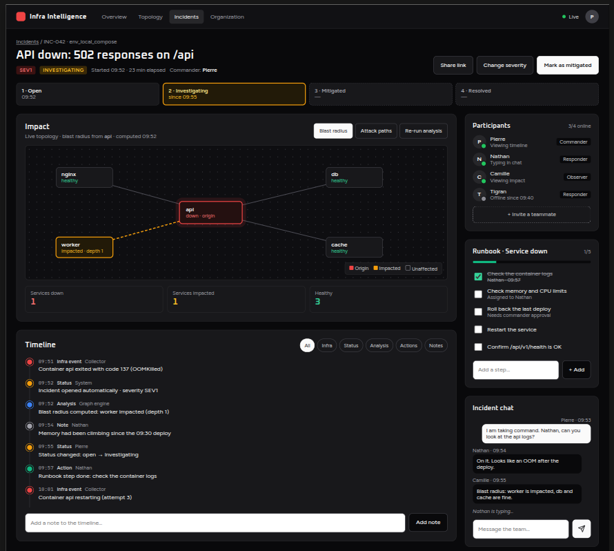

# Incident Room Contract

**Status: draft v0, frontend proposal.** Written from the frontend side (what the screens need). It is not agreed yet: the backend side (Nest) must review, correct and complete it. Everything here can change until both sides validate it.

Points marked **❓** are open questions. Each one has a proposal, but nothing is decided.

## In one sentence

The frontend loads an incident over REST, then joins the incident's realtime room to receive every change made by the other participants, while actions are sent over REST and broadcast by the server. Chat messages are the exception: they are sent over the socket.

## The screen



## Who uses it

- **Frontend (React)**: incident list, Incident Room screen (header, impact, timeline, participants, runbook, chat)
- **Nest backend**: incident state, persistence, permissions, realtime broadcast, calls to the Graph Engine
- **Collector (infra)**: indirectly, its events feed the timeline (through Nest, see [Collector contract](./collector-contract.md))
- **Graph Engine**: indirectly, its results feed the impact panel (through Nest, see [Graph contract](./graph-contract.md))

The browser talks to Nest only. Response envelopes and error format follow [API conventions](./api-conventions.md). Realtime rules follow [Real-time conventions](./realtime-conventions.md).

## Transport rule

Following [Graph contract](./graph-contract.md) ("auth, history, pagination, and analyze go over HTTP; live topology/incident updates go over the WebSocket"):

| Need                                             | Channel                                                        |
| ------------------------------------------------ | -------------------------------------------------------------- |
| Load an incident, its timeline, its chat history | REST                                                           |
| List incidents                                   | REST                                                           |
| Run an analysis or a simulation                  | REST ([Analyses API](./analysis-api.md))                       |
| Live graph of the environment                    | Socket: `topology:subscribe` ([Realtime topology protocol](./realtime-topology.md)) |
| Actions (status, severity, notes, runbook steps) | REST, then the server broadcasts the change over the socket    |
| Receive changes made by others                   | Socket                                                         |
| Presence, typing indicator                       | Socket                                                         |
| Send a chat message                              | Socket: `chat.send` command with acknowledgement               |

The server is authoritative. The frontend updates its state from the REST response or the broadcast event, never from what it assumes happened.

## Data model

Ids are opaque strings. Timestamps are ISO 8601 UTC. Node ids are the topology ids from the [Graph contract](./graph-contract.md).

### Enums

| Type                | Values                                                                               |
| ------------------- | ------------------------------------------------------------------------------------ |
| `IncidentSeverity`  | `sev1` (most severe) · `sev2` · `sev3` · `sev4`                                      |
| `IncidentStatus`    | `open` · `investigating` · `mitigated` · `resolved`                                  |
| `ParticipantRole`   | `commander` · `responder` · `observer`                                               |
| `TimelineEntryKind` | `infra_event` · `status_change` · `severity_change` · `analysis` · `action` · `note` |

### Types

```ts
interface IncidentSummary {
  id: string;
  title: string;
  severity: IncidentSeverity;
  status: IncidentStatus;
  environmentId: string;
  startedAt: string;
  resolvedAt: string | null;
  commander: UserRef | null;
  seedNodeIds: string[]; // services at the origin of the incident
}

interface Incident extends IncidentSummary {
  participants: Participant[];
  runbook: RunbookStep[];
  statusHistory: { status: IncidentStatus; at: string }[]; // for the status stepper
  myRole: ParticipantRole | null; // role of the current user, null if not a participant
  latestAnalysis: IncidentAnalysis | null; // null = not computed yet, the impact panel shows a loading state
}

// The incident's blast radius, saved by the server. Same shape as the `data` of an
// Analyses API response (./analysis-api.md), for `analyses: ["blast_radius"]`.
interface IncidentAnalysis {
  environmentId: string;
  topologyRevision: string; // "<epoch>:<revision>" of the topology that was analysed
  analyzedAt: string;
  freshness: "current" | "stale" | "unverifiable"; // as answered at computation time
  results: AnalysisResults; // Graph contract `results`, holding `blastRadius`
}

interface UserRef {
  id: string;
  displayName: string;
  avatarUrl: string | null;
}

interface Participant {
  user: UserRef;
  role: ParticipantRole;
  online: boolean;
  joinedAt: string;
}

interface TimelineEntry {
  id: string;
  incidentId: string;
  kind: TimelineEntryKind;
  occurredAt: string;
  summary: string; // human-readable text, shown as is by default
  author: UserRef | null; // null = system (collector, graph engine, backend)
  nodeIds: string[]; // services concerned, can be empty
  data: TimelineEntryData; // structured details, depends on `kind`
}

// `data.kind` always equals the entry's `kind`. The frontend uses `data` to enrich
// the display (status badges, link to a runbook step, highlight a node) and falls
// back to `summary` for anything it does not know.
type TimelineEntryData =
  | { kind: "status_change"; from: IncidentStatus; to: IncidentStatus }
  | { kind: "severity_change"; from: IncidentSeverity; to: IncidentSeverity }
  | { kind: "analysis"; analysis: "blast_radius"; affectedCount: number } // only the incident's saved blast radius
  | {
      kind: "action";
      action: "step_done" | "step_undone" | "step_assigned" | "role_changed" | "node_compromised" | "seeds_changed";
      stepId?: string; // step_done, step_undone, step_assigned
      userId?: string; // step_assigned (the assignee, absent = unassigned), role_changed
      nodeId?: string; // node_compromised
      fromNodeIds?: string[]; // seeds_changed: the previous seedNodeIds (the new ones are in the entry's nodeIds)
    }
  | { kind: "infra_event"; source: "collector"; eventType: string } // for example "container_died" (Collector contract)
  | { kind: "note" }; // nothing more, the text is in `summary`

interface RunbookStep {
  id: string;
  label: string;
  position: number;
  done: boolean;
  doneBy: UserRef | null;
  doneAt: string | null;
  assignee: UserRef | null; // participant in charge of the step, null = nobody
  createdBy: UserRef | null; // null = comes from a template
}

interface ChatMessage {
  id: string;
  incidentId: string;
  author: UserRef;
  body: string;
  sentAt: string;
  clientId: string | null; // id generated by the sender in `chat.send`, see "Sending a chat message"
}
```

### Example: `Incident`

```json
{
  "id": "inc_042",
  "title": "API down: 502 responses on /api",
  "severity": "sev1",
  "status": "investigating",
  "environmentId": "env_local_compose",
  "startedAt": "2026-09-14T09:52:00Z",
  "resolvedAt": null,
  "commander": {
    "id": "usr_pierre",
    "displayName": "Pierre",
    "avatarUrl": null
  },
  "seedNodeIds": ["svc_api"],
  "participants": [
    {
      "user": {
        "id": "usr_pierre",
        "displayName": "Pierre",
        "avatarUrl": null
      },
      "role": "commander",
      "online": true,
      "joinedAt": "2026-09-14T09:53:00Z"
    }
  ],
  "runbook": [
    {
      "id": "rbs_1",
      "label": "Check the container logs",
      "position": 1,
      "done": true,
      "doneBy": {
        "id": "usr_nathan",
        "displayName": "Nathan",
        "avatarUrl": null
      },
      "doneAt": "2026-09-14T09:57:30Z",
      "assignee": null,
      "createdBy": null
    }
  ],
  "statusHistory": [
    { "status": "open", "at": "2026-09-14T09:52:00Z" },
    { "status": "investigating", "at": "2026-09-14T09:55:00Z" }
  ],
  "myRole": "commander",
  "latestAnalysis": {
    "environmentId": "env_local_compose",
    "topologyRevision": "6f1c…:12",
    "analyzedAt": "2026-09-14T09:52:04Z",
    "freshness": "current",
    "results": {
      "blastRadius": {
        "seedNodeIds": ["svc_api"],
        "affectedNodeIds": ["svc_api", "svc_worker"],
        "affectedEdgeIds": ["edge_worker_api"],
        "depthByNodeId": { "svc_api": 0, "svc_worker": 1 }
      }
    }
  }
}
```

## REST endpoints

All endpoints are under `/api/v1`, require an authenticated session (`401 UNAUTHORIZED` otherwise), and use the `{ "data": … }` / `{ "error": … }` envelopes.

**Visibility:** every member of an organization can see all the incidents of that organization, participant or not. `GET /incidents` returns only the incidents of the user's organization. An incident of another organization behaves as if it did not exist: `404 INCIDENT_NOT_FOUND`, on REST and on `incident.join`. This needs the organization model.

### Incidents

| Method  | Path             | Body                                                        | Success                                               | MVP |
| ------- | ---------------- | ----------------------------------------------------------- | ----------------------------------------------------- | --- |
| `GET`   | `/incidents`     | query: `status`, `severity`, `environmentId` (all optional) | `200` `{ data: IncidentSummary[] }`                   | yes |
| `GET`   | `/incidents/:id` | none                                                        | `200` `{ data: Incident }`                            | yes |
| `POST`  | `/incidents`     | `{ title, severity, environmentId, seedNodeIds }`           | `201` `{ data: Incident }`, creator becomes commander | yes |
| `PATCH` | `/incidents/:id` | any of `{ status, severity, title, commanderId, seedNodeIds }` | `200` `{ data: Incident }`                            | yes |

Pagination of `GET /incidents` follows the project strategy once it is chosen (see [API conventions](./api-conventions.md)). **❓** Q3.

Rules for `seedNodeIds`, on `POST /incidents` and on `PATCH /incidents/:id`:

- `seedNodeIds` must hold at least one node: the impact panel opens on the blast radius, which needs a starting point. An empty list returns `400 VALIDATION_ERROR`.
- At most 50 ids, each one a node of the topology of `environmentId`, as in the [Analyses API](./analysis-api.md). Otherwise `400 VALIDATION_ERROR` with `details.seedNodeIds`. Duplicates are ignored.
- The blast radius is computed right after creation (see [The incident's blast radius](#the-incidents-blast-radius)).
- Changing `seedNodeIds` with `PATCH` is for when the team finds out the real origin is another service (for example the database rather than the API). The server replaces the list, adds an `action` timeline entry with `data.action: "seeds_changed"` (previous list in `data.fromNodeIds`, new list in the entry's `nodeIds`, for example "Pierre changed the origin to db"), broadcasts `incident.updated`, then recomputes the blast radius (`analysis.completed`).
- Sending the same list (in any order) returns `200` and changes nothing.

For the MVP, the incident list is loaded over REST only: it is reloaded each time the user comes back to it. Live updates of the list (a new incident appears without reloading) are an open question. **❓** Q10.

#### Handing over the commander role

`PATCH /incidents/:id` with `{ "commanderId": "<userId>" }` hands the commander role to someone else.

- Only the current commander can do it (see [Permissions](#permissions)).
- The new commander must be a participant of the incident, `responder` or `observer`. Otherwise `400 INCIDENT_INVALID_COMMANDER`.
- The new commander becomes `commander`; the former commander becomes `responder`, so they can keep helping.
- The server adds an `action` timeline entry with `data.action: "role_changed"` and `data.userId` = the new commander (for example "Pierre handed command to Nathan").
- The room receives `incident.updated` (new `commander`), then one `participant.updated` for each of the two people.
- Sending the current commander's own id returns `200` and changes nothing.

### Timeline

| Method | Path                      | Body                                                   | Success                                             | MVP |
| ------ | ------------------------- | ------------------------------------------------------ | --------------------------------------------------- | --- |
| `GET`  | `/incidents/:id/timeline` | query: `kind`, `nodeId`, `order` (all optional, below) | `200` `{ data: TimelineEntry[] }`, oldest first     | yes |
| `POST` | `/incidents/:id/notes`    | `{ body }` (1 to 2000 chars, same as a chat message)   | `201` `{ data: TimelineEntry }` with `kind: "note"`, `summary` = `body` | yes |

The backend adds the other timeline entries itself: a status change, a done runbook step, a computed analysis, an infra event on a seed node.

#### Filtering and sorting the timeline

A `GET` has no body, so the filters are query parameters:

| Parameter | Value                                                        | Default     | Example                               |
| --------- | ------------------------------------------------------------ | ----------- | ------------------------------------- |
| `kind`    | one or more `TimelineEntryKind`, comma-separated             | all kinds   | `?kind=status_change,severity_change` |
| `nodeId`  | a topology node id: only the entries whose `nodeIds` hold it | all entries | `?nodeId=svc_api`                     |
| `order`   | `asc` (oldest first) or `desc` (newest first)                | `asc`       | `?order=desc`                         |

- Parameters combine with AND: `?kind=infra_event&nodeId=svc_api` returns the infra events of `svc_api` only.
- An unknown `kind` or `order` value returns `400 VALIDATION_ERROR`. An unknown `nodeId` returns an empty list.
- The filter chips of the screen map to kinds as follows:

| Chip     | `kind` sent                     |
| -------- | ------------------------------- |
| All      | none                            |
| Infra    | `infra_event`                   |
| Status   | `status_change,severity_change` |
| Analysis | `analysis`                      |
| Actions  | `action`                        |
| Notes    | `note`                          |

- Live entries (`timeline.entry_added`) are not filtered by the server: every client in the room receives all of them, and the frontend hides those that do not match the active filter. This way, changing the filter does not change the socket subscription.

### Participants

| Method  | Path                                  | Body                                      | Success                                     | MVP |
| ------- | ------------------------------------- | ----------------------------------------- | ------------------------------------------- | --- |
| `GET`   | `/incidents/:id/invitable-users`      | query: `q` (optional), `limit` (optional) | `200` `{ data: UserRef[] }`, sorted (below) | V2  |
| `POST`  | `/incidents/:id/participants`         | `{ userId, role }`                        | `201` `{ data: Participant }`               | V2  |
| `PATCH` | `/incidents/:id/participants/me`      | `{ role: "responder" \| "observer" }`     | `200` `{ data: Participant }`               | yes |
| `PATCH` | `/incidents/:id/participants/:userId` | `{ role }`                                | `200` `{ data: Participant }`               | V2  |

#### Inviting a teammate

Clicking "Invite a teammate" opens a search field with a list of teammates. The list comes from `GET /incidents/:id/invitable-users` and narrows as the user types.

1. On open, the frontend calls the endpoint without `q`: the server returns the first teammates in alphabetical order.
2. On each keystroke, the frontend calls it again with the letters typed so far, `?q=ca`. It waits 250 ms after the last keystroke before calling (debounce) and ignores the answer of an older request if a newer one was sent.
3. Choosing a teammate calls `POST /incidents/:id/participants` with `{ userId, role: "responder" }`. The server broadcasts `participant.joined`.
   If the user does not exist or belongs to another organization: `404 USER_NOT_FOUND` (same answer in both cases, so the endpoint does not reveal who exists). If they are already a participant: `409 INCIDENT_ALREADY_PARTICIPANT`.

Server rules:

| Rule        | Detail                                                                                                                                  |
| ----------- | --------------------------------------------------------------------------------------------------------------------------------------- |
| Who         | Members of the incident's organization who are not participants yet. The current user is never returned.                                |
| Match       | `q` is compared to `displayName`, ignoring case and accents (`ca` matches "Camille", "Ça va", "Ducasse").                               |
| Sort        | 1. names that start with `q` · 2. names with a word starting with `q` · 3. names that contain `q` · then alphabetical inside each group |
| `q`         | 0 to 50 chars, trimmed. Empty or missing = no filter, alphabetical order.                                                               |
| `limit`     | 1 to 20, default 10.                                                                                                                    |
| Permissions | Only roles allowed to invite (see [Permissions](#permissions) and Q9); others get `403 FORBIDDEN`.                                     |

Example: `GET /incidents/inc_042/invitable-users?q=ca`

```json
{
  "data": [
    { "id": "usr_camille", "displayName": "Camille", "avatarUrl": null },
    { "id": "usr_lucas", "displayName": "Lucas Carpentier", "avatarUrl": null },
    { "id": "usr_oscar", "displayName": "Oscar", "avatarUrl": null }
  ]
}
```

"Camille" starts with `ca`, "Lucas Carpentier" has a word starting with `ca`, "Oscar" only contains `ca`.

This endpoint needs the organization model. **❓** Q9.

#### Joining an incident

Opening an incident makes the user an `observer`. To take part, they switch to `responder` with the "Join as responder" button.

1. When a user who is not a participant yet sends `incident.join`, the server adds them as `observer` and broadcasts `participant.joined`. A user who is already a participant keeps their role.
2. "Join as responder" calls `PATCH /incidents/:id/participants/me` with `{ "role": "responder" }`. The server broadcasts `participant.updated`.
3. A responder can go back to `observer` the same way, with `{ "role": "observer" }`.

Rules for `PATCH …/participants/me`:

- Only `responder` and `observer` are accepted. Becoming commander goes through `PATCH /incidents/:id` with `commanderId`.
- The commander cannot change their own role this way: they first hand over the commander role. Otherwise `409 INCIDENT_COMMANDER_REQUIRED`.
- Each change adds an `action` timeline entry (for example "Camille joined as responder").

### Runbook

| Method   | Path                                   | Body                                           | Success                                            | MVP                                     |
| -------- | -------------------------------------- | ---------------------------------------------- | -------------------------------------------------- | --------------------------------------- |
| `POST`   | `/incidents/:id/runbook-steps`         | `{ label, assigneeId? }`                       | `201` `{ data: RunbookStep }`, appended at the end | yes                                     |
| `PATCH`  | `/incidents/:id/runbook-steps/:stepId` | any of `{ done, label, assigneeId, position }` | `200` `{ data: RunbookStep }`                      | yes (`done`, `assigneeId`), V2 (others) |
| `DELETE` | `/incidents/:id/runbook-steps/:stepId` | none                                           | `204`                                              | V2                                      |

Fields of the body:

| Field        | Type             | Rule                                                                                                           |
| ------------ | ---------------- | -------------------------------------------------------------------------------------------------------------- |
| `label`      | `string`         | 1 to 200 chars, required on `POST`                                                                             |
| `assigneeId` | `string \| null` | optional; the `id` of a participant of the incident (commander or responder). `null` or missing = not assigned |

- The frontend fills the assignee list from `Incident.participants`: no extra call is needed.
- `PATCH` with `{ "assigneeId": null }` removes the assignee; with another id, it reassigns the step.
- `PATCH` with `{ "done": true }` sets `doneBy` (the current user) and `doneAt`. `{ "done": false }` unticks the step and sets both back to `null`. Each one adds an `action` timeline entry (for example "Nathan unticked _Restart the service_").
- An `assigneeId` that is not a commander or responder of this incident returns `400 RUNBOOK_INVALID_ASSIGNEE`.
- Creating an assigned step, or changing its assignee, adds an `action` timeline entry (for example "Pierre assigned _Restart the service_ to Nathan") and sends `runbook.step_added` or `runbook.step_updated` with the full step.

### Chat

| Method | Path                      | Body                                   | Success                                                | MVP |
| ------ | ------------------------- | -------------------------------------- | ------------------------------------------------------ | --- |
| `GET`  | `/incidents/:id/messages` | query: `before` (message id, optional) | `200` `{ data: ChatMessage[], meta: { hasMore } }`, last 50, oldest first | yes |

REST only loads the chat history. Sending a message goes through the socket (`chat.send`, see [Sending a chat message](#sending-a-chat-message)). There is no `POST /incidents/:id/messages`.

Loading older messages:

- Without `before`, the server returns the 50 most recent messages. With `?before=<messageId>`, it returns the 50 messages just before that one.
- `meta.hasMore` is `true` when older messages exist. The frontend shows "Load older messages" only in that case, and passes the `id` of the oldest message it shows as `before`.
- An unknown `before` id returns `400 VALIDATION_ERROR`.

```json
{
  "data": [{ "id": "msg_101", "incidentId": "inc_042", "author": { "id": "usr_nathan", "displayName": "Nathan", "avatarUrl": null }, "body": "On it.", "sentAt": "2026-09-14T09:54:00Z", "clientId": null }],
  "meta": { "hasMore": true }
}
```

### Impact and analyses

The impact panel reuses what already exists on `main`:

- **The graph** comes from the [Realtime topology protocol](./realtime-topology.md): `topology:subscribe`, then `topology:snapshot` and `topology:delta`. There is no REST endpoint for the topology.
- **Analyses** use the [Analyses API](./analysis-api.md): `POST /api/v1/environments/:envId/analyses`. Its limits, response (`topologyRevision`, `freshness`, `results`) and errors apply as written there. Its answer goes to the user who asked only, and nothing is stored.

This contract only adds what is specific to an incident: a blast radius saved with the incident and shared with the room, and the "Mark as compromised" action.

| Method | Path                                       | Body                                     | Success                                   | MVP |
| ------ | ------------------------------------------ | ---------------------------------------- | ----------------------------------------- | --- |
| `POST` | `/incidents/:id/blast-radius`              | none                                     | `200` `{ data: IncidentAnalysis }`        | yes |
| `POST` | `/incidents/:id/compromised-nodes`         | `{ nodeId }`                             | `200` `{ data: GraphNode }`               | yes |
| `POST` | `/environments/:envId/analyses` (existing) | see [Analyses API](./analysis-api.md)    | `200`, answer to the caller only          | yes |

#### The incident's blast radius

The impact panel opens on **Blast radius** (frontend choice: it answers the first question of an incident, "what is affected?"). So it must be ready when someone opens the incident.

- The backend computes it by itself, through the analysis module, with the incident's `seedNodeIds`: when the incident is created, when its `seedNodeIds` change, when a node becomes `compromised`.
- `POST /incidents/:id/blast-radius` computes it again on demand (the "Re-run analysis" button), same rules.
- Each computation saves the result in `Incident.latestAnalysis`, adds an `analysis` timeline entry and broadcasts `analysis.completed` to the room.
- The frontend reads `latestAnalysis` from `GET /incidents/:id` on load and on reconnect: no extra call is needed. If it is `null`, the panel shows a loading state until `analysis.completed` arrives.
- If the computation fails (`ANALYSIS_UNAVAILABLE`, `GRAPH_ENGINE_FAILURE`, `TOPOLOGY_UNAVAILABLE`, see the Analyses API), `POST …/blast-radius` answers that error, an automatic computation broadcasts `analysis.failed` with `{ incidentId, error: { code } }`, and `latestAnalysis` keeps its previous value. The panel shows the error with a "Re-run analysis" button.

Reading the result, as the Analyses API asks:

- `freshness` `stale` or `unverifiable` is shown as such, never as "no service affected": an empty list means something only when `freshness` is `current`.
- The topology keeps moving after the computation. When `latestAnalysis.topologyRevision` differs from the `<epoch>:<revision>` of the snapshot or delta the panel shows, the panel marks the result as outdated and offers "Re-run analysis".

#### Attack paths and simulations

Both go straight to the Analyses API: the answer goes to the user who asked only, it is not saved, not broadcast and not added to the timeline.

| Use                               | Body sent to `POST /environments/:envId/analyses`                                  |
| --------------------------------- | ---------------------------------------------------------------------------------- |
| "Attack paths" tab                | `{ "analyses": ["attack_paths"], "seedNodeIds": <the incident's seedNodeIds> }`  |
| Simulation ("what if this node…") | `{ "analyses": ["blast_radius", "attack_paths"], "seedNodeIds": [<chosen node>] }` |

The attack paths are computed each time the tab is opened, since nothing is stored. **❓** Q7.

#### Mark as compromised

- `POST /incidents/:id/compromised-nodes` is the manual "Mark as compromised" action. It goes through the incident so that the server knows which role to check and the action shows in the incident's timeline:
  - the server checks the user's role in this incident (see [Permissions](#permissions)) and that `nodeId` is a node of the topology of the incident's environment, otherwise `400 VALIDATION_ERROR` with `details.nodeId` (same rule as the Analyses API);
  - it sets the node's status to `compromised` for the whole environment: every client watching the live graph receives it through the topology deltas;
  - it adds an `action` timeline entry with `data.action: "node_compromised"` and the node in `nodeIds` (for example "Pierre marked api as compromised"): it is a human action, not an infra event;
  - marking a node that is already `compromised` returns `200` and changes nothing (no new timeline entry).
- Marking a node from the Topology view, outside any incident, is not part of this contract (later, at the environment level).
- **❓** Q5: is a manual status allowed to override the status computed from Docker, and until when?

## Realtime

Library: Socket.IO, already used by the [Realtime topology protocol](./realtime-topology.md) (connection, session cookie, reconnection). Every message uses the envelope from [Real-time conventions](./realtime-conventions.md):

```json
{
  "event": "timeline.entry_added",
  "payload": {},
  "timestamp": "2026-09-14T09:54:12Z"
}
```

### Room

One server-managed room per incident, for example `incident:inc_042`. The client asks to join; the server checks the session and that the user is a member of the incident's organization. Guessing an id gives no access.

### Client → server

| Event            | Payload                          | Acknowledgement                                                       |
| ---------------- | -------------------------------- | --------------------------------------------------------------------- |
| `incident.join`  | `{ incidentId }`                 | `{ ok: true }` or `{ ok: false, error: { code } }`                    |
| `incident.leave` | `{ incidentId }`                 | none                                                                  |
| `chat.typing`    | `{ incidentId }`                 | none (sent at most every 3 s)                                         |
| `chat.send`      | `{ incidentId, body, clientId }` | `{ ok: true, data: ChatMessage }` or `{ ok: false, error: { code } }` |

### Server → clients in the room

Every event sent to a room carries `incidentId` in its payload, even when the object inside also has it. A client can be in several rooms (several tabs, a dashboard later): it uses `incidentId` to know which incident the event is about and ignores events of incidents it no longer shows.

| Event                  | Payload                                                    | Sent when                                         |
| ---------------------- | ---------------------------------------------------------- | ------------------------------------------------- |
| `incident.updated`     | `{ incidentId, incident: IncidentSummary, statusHistory }` | status, severity, title, commander or origin (`seedNodeIds`) changed |
| `timeline.entry_added` | `{ incidentId, entry: TimelineEntry }`                     | any new timeline entry                            |
| `participant.joined`   | `{ incidentId, participant: Participant }`                 | a user joins the incident                         |
| `participant.updated`  | `{ incidentId, participant: Participant }`                 | role changed                                      |
| `presence.updated`     | `{ incidentId, userId, online }`                           | a participant connects or disconnects             |
| `runbook.step_added`   | `{ incidentId, step: RunbookStep }`                        | a step is created                                 |
| `runbook.step_updated` | `{ incidentId, step: RunbookStep }`                        | a step is changed (done, label…)                  |
| `runbook.step_removed` | `{ incidentId, stepId }`                                   | a step is deleted (V2)                            |
| `chat.message`         | `{ incidentId, message: ChatMessage }`                     | a new message                                     |
| `chat.typing`          | `{ incidentId, userId }`                                   | someone is typing (the client hides it after 5 s) |
| `analysis.completed`   | `{ incidentId, analysis: IncidentAnalysis }`               | the incident's blast radius was (re)computed      |
| `analysis.failed`      | `{ incidentId, error: { code } }`                          | an automatic blast radius computation failed      |

Topology changes (a container dies, a node becomes `compromised`) go through the topology deltas of the live graph, not through these events. **❓** Q4.

### Server → one client

| Event                   | Payload                  | Sent when                            |
| ----------------------- | ------------------------ | ------------------------------------ |
| `incident.removed_from` | `{ incidentId, reason }` | the user lost access to the incident |

### Sending a chat message

The chat uses the socket, not REST. A chat is a stream of short, frequent messages between people who are already connected to the room, so the socket is the natural channel and avoids an HTTP round trip per message. Every other action stays in REST.

1. The client must have joined the room (`incident.join`) first.
2. It sends `chat.send` with `{ incidentId, body, clientId }`. `clientId` is a unique id generated by the client (UUID). The message is shown as "sending" until the acknowledgement arrives.
3. The server checks the session, the user's role (see [Permissions](#permissions)) and the body (1 to 2000 chars), saves the message, then:
   - replies to the sender with the acknowledgement `{ ok: true, data: ChatMessage }`;
   - broadcasts `chat.message` to everyone in the room, sender included (useful when the same user has several tabs open).
4. The client replaces its "sending" message with the `ChatMessage` from the acknowledgement, and ignores a `chat.message` whose `id` it already shows.

An observer can read the chat but not write in it: the frontend disables the message field and shows "Join as responder to write". If an observer still sends `chat.send`, the server answers `FORBIDDEN`. The server also ignores `chat.typing` from an observer.

Errors come back in the acknowledgement, with the same codes as REST: `VALIDATION_ERROR`, `FORBIDDEN`, `INCIDENT_NOT_FOUND`. The client shows the message as failed, with a "retry" button.

No acknowledgement after 10 s (connection lost): the client shows the message as failed and offers to retry. A retry reuses the same `clientId`: if the server already saved that message, it returns the existing `ChatMessage` instead of creating a duplicate.

`ChatMessage` gets an extra field `clientId: string | null` (the value sent in `chat.send`), so the sender can match the broadcast with its pending message even if the acknowledgement was lost.

### Reconnect

On reconnect, the client sends `incident.join` again, then reloads in parallel:

| Call                          | Brings back                                                        |
| ----------------------------- | ------------------------------------------------------------------ |
| `GET /incidents/:id`          | status, severity, participants, runbook, `latestAnalysis`          |
| `GET /incidents/:id/timeline` | the timeline, with the filters currently active (`kind`, `nodeId`) |
| `GET /incidents/:id/messages` | the last 50 chat messages                                          |

- The client never assumes its local state is still current: the incident and the timeline replace what it had.
- Chat messages are merged with the ones already shown, by `id`, so nothing is shown twice and older messages already loaded stay.
- Messages still "sending" when the connection dropped follow the usual rule: failed after 10 s, then retry with the same `clientId` (see [Sending a chat message](#sending-a-chat-message)).
- Events received between `incident.join` and the end of the reloads are applied after them, so they are not overwritten.

**❓** Q2: should the server send a full snapshot in the `incident.join` acknowledgement instead?

## Permissions

| Action                                 | commander | responder  | observer | not a participant |
| -------------------------------------- | --------- | ---------- | -------- | ----------------- |
| See the incident                       | yes       | yes        | yes      | yes (same organization) |
| Change status, severity, commander, origin (`seedNodeIds`) | yes | no | no | no |
| Add a note, tick or add a runbook step | yes       | yes        | no       | no                |
| Untick a runbook step                  | yes       | yes        | no       | no                |
| Assign or reassign a runbook step      | yes       | yes        | no       | no                |
| Send a chat message                    | yes       | yes        | no       | no                |
| Re-run the incident's blast radius     | yes       | yes        | yes      | no                |
| Attack paths, simulation               | yes       | yes        | yes      | yes (Analyses API: any signed-in user) |
| Mark a node as compromised             | yes       | yes        | no       | no                |
| Switch own role (responder ↔ observer) | no        | yes        | yes      | no                |
| Invite a teammate (V2)                 | yes       | **❓** Q9 | no       | no                |

## Status transitions

```text
open → investigating → mitigated → resolved
```

- Moving forward one or several steps is allowed.
- Going back (for example `mitigated → investigating` when the fix did not work) is allowed. **❓** Q6: can a `resolved` incident be reopened?
- Each change adds a `status_change` timeline entry and an `incident.updated` event.
- Moving to `resolved` sets `resolvedAt`.

## Severity changes

- Any severity can be set, up or down (`sev1` ↔ `sev4`). Only the commander can change it (see [Permissions](#permissions)).
- Each change adds a `severity_change` timeline entry with `data: { from, to }` (for example "Pierre changed severity from SEV2 to SEV1") and an `incident.updated` event.
- Sending the current severity returns `200` and changes nothing: no timeline entry, no event.

## New error codes

To add to the table in [API conventions](./api-conventions.md) once agreed:

| Code                          | Status | When                                                                    |
| ----------------------------- | ------ | ----------------------------------------------------------------------- |
| `INCIDENT_NOT_FOUND`          | 404    | unknown incident id, or incident of another organization                |
| `RUNBOOK_INVALID_ASSIGNEE`    | 400    | the assignee is not a commander or responder of this incident           |
| `RUNBOOK_STEP_NOT_FOUND`      | 404    | unknown step id in this incident                                        |
| `USER_NOT_FOUND`              | 404    | unknown user, or user of another organization (invitation)              |
| `FORBIDDEN`                   | 403    | the user's role does not allow the action                               |
| `INCIDENT_ALREADY_PARTICIPANT` | 409  | the invited user is already a participant of the incident               |
| `INCIDENT_INVALID_COMMANDER`  | 400    | the new commander is not a participant of the incident                  |
| `INCIDENT_COMMANDER_REQUIRED` | 409    | the commander tried to change their own role without handing it over    |
| `INCIDENT_INVALID_TRANSITION` | 409    | the status change is not allowed (for example reopening, if Q6 says no) |

`VALIDATION_ERROR` (400) covers invalid bodies (empty note, unknown severity, unknown node id in `seedNodeIds` or `nodeId`…), as everywhere else. The analysis errors (`ANALYSIS_UNAVAILABLE`, `GRAPH_ENGINE_FAILURE`, `TOPOLOGY_UNAVAILABLE`, `TOPOLOGY_UNKNOWN_ENVIRONMENT`) already exist: see the [Analyses API](./analysis-api.md).

## Open questions

| #   | Question                                                                                                             | Frontend proposal                                                                                                      | For             |
| --- | -------------------------------------------------------------------------------------------------------------------- | ---------------------------------------------------------------------------------------------------------------------- | --------------- |
| Q1  | Who creates an incident: the user, the backend automatically, or both?                                               | Both: manual creation for the MVP, automatic creation (container down) when detection exists                           | Nathan, Tigran  |
| Q2  | Reconnect: full snapshot in the `incident.join` ack, or REST reload?                                                 | REST reload (simpler, one source of truth)                                                                             | Nathan          |
| Q3  | Pagination of the incident list and the timeline?                                                                    | No pagination for the MVP (small volume); cursor later, combined with the timeline filters (`kind`, `nodeId`, `order`) | Nathan          |
| Q4  | Do topology changes reach the Incident Room through the topology deltas, or through incident events?                 | Topology deltas (same live graph as the Overview)                                                                      | Nathan          |
| Q5  | Where does the `compromised` status come from? Manual only, WAF alerts, collector signals, a tool like Falco?        | Manual for the MVP                                                                                                     | Tigran + Nathan |
| Q6  | Can a `resolved` incident be reopened?                                                                               | Yes, by the commander                                                                                                  | Team            |
| Q7  | Should the attack paths also be computed and saved with the incident (like the blast radius) when a node becomes `compromised`? Today they go through the Analyses API, on demand, not saved | Yes, when a seed node is `compromised`; otherwise on demand | Team |
| Q8  | Where do runbook templates come from (hard-coded, database, per incident type)?                                      | Hard-coded "Service down" template for the MVP                                                                         | Team            |
| Q9  | Invitations: who can invite (commander only, or responders too), and who can be invited (organization members only)? | Commander and responders; organization members only                                                                    | Team            |
| Q10 | Live incident list: how does a new or changed incident reach the list without reloading? | V2: one room per organization (`org:<orgId>`), joined automatically on connect after the membership check; events `incident.created` and `incident.summary_updated`, both `{ incidentId, incident: IncidentSummary }`. MVP: REST reload when the user comes back to the list | Team |

## MVP scope

**In:** incident list, incident detail, create, change status, severity, title and commander, timeline (read + notes + live + filters), runbook (tick + add + assign), participants (list + join as observer + switch to responder), chat (send + live), blast radius, manual "compromised", attack simulation, reconnect.

**Later:** roles and invitations, presence and typing, runbook step edit and delete, templates, pagination, mentions, replay, post-mortem.
