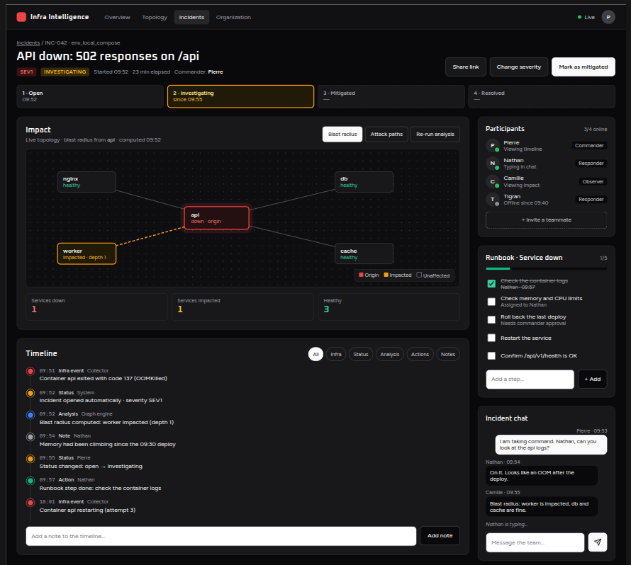

# Incident Room — frontend integration contract (implemented v1)

**Status:** Implemented backend contract; frontend integration guide.

**Scope:** Manual incidents, REST state and timeline, live Socket.IO notifications.

**Source of truth:** [Incidents API](./incidents-api.md), [ADR 0004](../adr/0004-incident-events-and-topology-history.md), and the backend implementation. If this guide differs from those sources, follow the implemented API.

**Design provenance:** Adapted from the frontend proposal in [PR #121](https://github.com/tigran-sargsyan-w/ft_transcendence/pull/121). Preserve the original ideas in the [future proposal](./incident-room-future-proposal.md) and [historical draft](./incident-room-original-proposal.md).

## Screen and integration boundaries



The browser calls NestJS via same-origin `/api/v1` REST and connects to the same origin using Socket.IO (`/socket.io/`). It never calls PostgreSQL, the Collector, or Graph Engine directly. The backend is authoritative: do not infer a successful state change before REST or the live event confirms it.

| Screen capability | v1 backend | Frontend behavior |
| --- | --- | --- |
| Incident list, create, detail, status/severity/title/commander | Implemented | Use incidents REST API |
| Timeline, notes, live incident events | Implemented | Load over REST; subscribe to incident room |
| Infrastructure graph | Implemented separately | Subscribe using `topology:subscribe` |
| Blast radius / attack paths / critical nodes | Implemented separately | Call the Analyses API on demand; no saved incident analysis |
| Public display name and avatar | Implemented | Read from incident `commander` / timeline `author` |
| Friends' online status | Implemented separately | `presence:changed` is **friends-only**, not incident presence |
| Incident participants/roles, chat, runbook, invitations | **Not implemented** | Hide/disable panels; don't call speculative endpoints |
| Auto incident creation, persisted analyses, replay UI, live incident list | **Not implemented** | Tracked in the [future proposal](./incident-room-future-proposal.md) |

## Authentication and transport

- A valid `sid` HttpOnly cookie authenticates both REST and Socket.IO; the browser should use same-origin URLs and `credentials: 'include'` for fetch. Do not read or store session tokens in JavaScript.
- For local development, use the application's HTTPS entry point (`https://localhost:8443`) configured by the project, not an insecure direct backend port.
- REST returns `{ "data": ... }` on success and `{ "error": { "code": "...", "message": "...", "details": ... } }` on failure.
- Live server events use `{ event, payload, timestamp }`; socket command acknowledgements use `{ data }` or `{ error }`.
- In v1, **any signed-in user can read, update, and join any incident**. There are no incident roles or organization boundaries yet. This is suitable only for the project's demo data, not production multi-tenancy.

See [Authentication and users](./auth-and-users.md), [API conventions](./api-conventions.md), and [Realtime topology protocol](./realtime-topology.md).

## REST API — implemented

All paths below are relative to `/api/v1`; each requires an authenticated session.

| Method | Path | Input | Success |
| --- | --- | --- | --- |
| `GET` | `/incidents` | Optional query `status`, `severity`, `environmentId` | `200`, `IncidentSummary[]` newest first |
| `POST` | `/incidents` | `{ title, severity, environmentId, seedNodeIds }` | `201`, full `Incident` |
| `GET` | `/incidents/:id` | UUID | `200`, full `Incident` |
| `PATCH` | `/incidents/:id` | `{ version, status?, severity?, title?, commanderId? }` with at least one field to change | `200`, full `Incident` |
| `GET` | `/incidents/:id/timeline` | Optional `kind` (comma-separated), `order` (`asc`/`desc`), `nodeId` | `200`, `TimelineEntry[]` |
| `POST` | `/incidents/:id/notes` | `{ body }` | `201`, `TimelineEntry` |

- Incident and user IDs are **UUIDs**; do not use mock IDs such as `inc_042` in requests.
- `severity`: `sev1`, `sev2`, `sev3`, `sev4`. `status`: **only** `open`, `investigating`, `resolved`; `mitigated` is not supported in v1.
- `title`: 1–200 characters after trimming. Notes: 1–2,000 characters after trimming.
- `seedNodeIds`: 1–50 actual topology node IDs. Set at creation; **cannot be changed via PATCH** in v1. The environment must be known and have a topology snapshot.
- The creator becomes commander; in v1 `commanderId` can be any existing user's UUID, because there are no participant-role checks.
- The list and timeline are **not paginated**. `nodeId` filtering currently returns no entries, because v1 incident events have no associated node IDs.
- Reopening a resolved incident is allowed. Notes don't increment the incident version.

### Data to render

Minimal TypeScript interface outline (see the canonical API page for the complete contract):

```ts
type IncidentStatus = 'open' | 'investigating' | 'resolved';
type IncidentSeverity = 'sev1' | 'sev2' | 'sev3' | 'sev4';

type UserRef = {
  id: string;
  displayName: string;
  avatarUrl: string | null;
};

type IncidentSummary = {
  id: string;
  title: string;
  severity: IncidentSeverity;
  status: IncidentStatus;
  environmentId: string;
  startedAt: string;
  resolvedAt: string | null;
  commander: UserRef;
  seedNodeIds: string[];
};

type Incident = IncidentSummary & {
  version: number;
  participants: [];          // v1: not implemented
  runbook: [];               // v1: not implemented
  statusHistory: { status: IncidentStatus; at: string }[];
  myRole: null;              // v1: no participant roles
  latestAnalysis: null;      // v1: not computed or stored
};

type TimelineEntry = {
  id: string;
  seq: number;
  incidentId: string;
  kind: 'status_change' | 'severity_change' | 'action' | 'note' |
        'infra_event' | 'analysis';
  occurredAt: string;
  summary: string;
  author: UserRef | null;
  nodeIds: string[];
  data: Record<string, unknown>;
};
```

Do **not** treat `latestAnalysis: null` as an analysis still loading; it means no saved analysis exists in v1. The timeline's supported actions currently include `created`, `title_changed`, and `role_changed`; render `summary` when an action is not recognized. A timeline entry's `seq` establishes its order and can contain gaps.

### Optimistic locking and errors

For a state change, send the version last received via `GET`, `PATCH`, or `incident:updated`:

```http
PATCH /api/v1/incidents/<incident-uuid>
Content-Type: application/json

{"version": 2, "status": "investigating"}
```

- Successful actual change: `200`, incremented `version`, timeline event(s), then live notifications after commit.
- No-op (values already match): `200`, unchanged `version`, **no** live notification.
- Concurrent edit: `409 INCIDENT_VERSION_CONFLICT`; `error.details` contains the current **full Incident**. Present the conflict, refresh local state, and ask the user to reconsider rather than silently retrying over another person's change.
- Bad or unknown fields: `400 VALIDATION_ERROR`; invalid UUID route: `400 BAD_REQUEST`; unknown incident: `404 INCIDENT_NOT_FOUND`.
- Other errors and rate limits: see [Incidents API](./incidents-api.md#errors).

## Socket.IO — implemented incident room

Use the same authenticated Socket.IO client as topology. A socket can join multiple incident rooms; the client never supplies a raw room name. Each socket command counts toward the gateway limit of 10 commands per 10 seconds.

| Client command | Body | Acknowledgement |
| --- | --- | --- |
| `incident:join` | `{ incidentId: '<uuid>' }` | `{ data: { incidentId: '<canonical-uuid>' } }` or `{ error }` |
| `incident:leave` | `{ incidentId: '<uuid>' }` | `{ data: {} }` or `{ error }` |

Join looks up the incident; a nonexistent ID yields `INCIDENT_NOT_FOUND`. Leave is safe even if the socket never joined. Canonical lower-case UUIDs are used for the server-managed `incident:<id>` room.

| Server event | `payload` | Trigger |
| --- | --- | --- |
| `incident:updated` | `{ incidentId, incident }` where `incident` is the **full `Incident`, including `version`** | A real state change committed |
| `timeline:entry_added` | `{ incidentId, entry }` | Each new timeline entry; notes only generate this event |

The server sends `incident:updated` **before** the entries from the same update, and timeline entries in `seq` order. All currently joined sockets receive the event, including the user who made the REST call. There is no live `incident:created` or incident-list event in v1; refresh the list via REST when returning to it.

### Opening a room and recovering after reconnect

1. Establish the authenticated Socket.IO connection and attach event listeners.
2. Send `incident:join` and wait for its acknowledgement.
3. Fetch `GET /incidents/:id` and `GET /incidents/:id/timeline` to establish the authoritative state; buffer any live events received while fetching.
4. Apply fetched state and then reconcile buffered messages: ignore incident updates with older/equal `version`, reload on version gaps, deduplicate timeline entries by `id`, and sort by `seq`.
5. On **every** reconnection, repeat steps 2–4. Socket.IO's new socket is not automatically subscribed to previous rooms.
6. When leaving the screen, send `incident:leave` (if still connected); stop consuming the room's events. Other joined rooms can stay active.

An event may be missed if the server crashes after committing but before emitting; REST synchronization is required, not optional. Do not assume that `incident:updated` events alone fully represent historical state.

### Presence is separate from incident membership

`presence:changed` has `{ userId, isOnline }` and is sent only to **accepted friends**, not to incident participants. Friendship is managed by [User Management](./user-management-frontend-api.md). Incident `participants` is an empty array in v1. Do **not** implement `presence:updated`, `participant:joined`, or `participant:updated` from the original draft as if they already existed.

## Impact graph and analyses

- Get the live infrastructure graph through `topology:subscribe`, with snapshots/deltas and `epoch`/`revision` reconciliation described in [Realtime topology protocol](./realtime-topology.md).
- For a selected incident, use its `environmentId` and `seedNodeIds` to call **`POST /api/v1/environments/:environmentId/analyses`**, e.g. `{ "analyses": ["blast_radius"], "seedNodeIds": incident.seedNodeIds }`.
- `attack_paths` also requires seeds; `critical_nodes` does not. Results are **not** attached to the incident or stored in the incident timeline in v1.
- Render `freshness: 'current' | 'stale' | 'unverifiable'` faithfully; never interpret an empty stale/unverifiable analysis as proof of safety. See [Analyses API](./analysis-api.md).
- A future `compromised` mark is **not** the same thing as a Docker container's current health/status; see the [future proposal](./incident-room-future-proposal.md).

## Frontend checklist

- [ ] Incident list uses `/incidents` and refreshes on navigation; it does not expect an environment-room incident stream.
- [ ] Incident detail + timeline load from REST after `incident:join` and after reconnect.
- [ ] Status, severity, title, and commander changes include `version`; handle `409` without silent overwrite.
- [ ] Apply full `Incident` from `incident:updated`, not the draft `IncidentSummary` payload.
- [ ] Deduplicate timeline entries and process `seq` in order; fall back to entry `summary`.
- [ ] Validate UUID inputs; keep seed nodes immutable after creation; expose only three statuses.
- [ ] Use topology events and the Analyses API for the graph/impact panel; show freshness.
- [ ] Keep speculative participants, chat, runbook, saved analyses, and incident presence controls disabled/hidden in v1.

## References

- Canonical backend [Incidents API](./incidents-api.md) and [ADR 0004](../adr/0004-incident-events-and-topology-history.md).
- [Realtime topology protocol](./realtime-topology.md) and [User Management frontend integration](./user-management-frontend-api.md).
- [Future Incident Room design proposal](./incident-room-future-proposal.md) and [archived original frontend draft](./incident-room-original-proposal.md).
