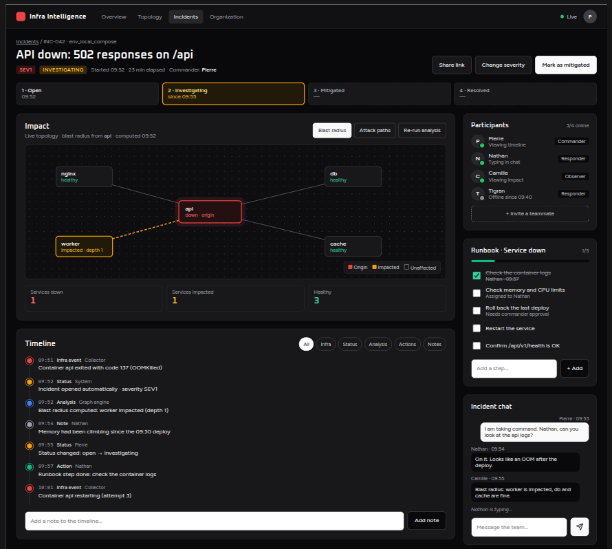

# Incident Room — future design proposal (v2+)

**Status: PROPOSED — NOT IMPLEMENTED.** This document captures product and frontend ideas from Pierre-Antoine's original [PR #121](https://github.com/tigran-sargsyan-w/ft_transcendence/pull/121) and incorporates the backend review by Nathan (6 November 2026). It is a **backlog/design proposal, not an API contract**. Names, endpoints, payloads, authorization rules, and scheduling require team review and separate implementation PRs.

**Current implementation:** [Incident Room frontend integration v1](./incident-room-contract.md) and the canonical [Incidents API](./incidents-api.md).

**Full original draft:** [Archived frontend proposal v0](./incident-room-original-proposal.md) — its detailed types, sample payloads, endpoints, permissions matrix, UI assumptions and open questions are retained verbatim for reference. Do not implement its endpoints without verifying them against the backend.

## Product vision and preserved mockup

The Incident Room is a collaborative operational workspace surrounding an infrastructure incident: live graph and impact assessment, append-only timeline, people and responsibility, response runbook, chat, decisions, and later incident replay. The browser uses Nest as its authoritative API, with the Collector and Graph Engine behind it. The starting product is an infrastructure intelligence platform, not a generic messaging app.

The original proposal is intentionally ambitious. **No row in this document means a feature is already available.** Prioritization below is suggested, not approved.

## Status and migration map

| Capability | v1 reality | Proposed evolution / constraints |
| --- | --- | --- |
| Incident status | `open`, `investigating`, `resolved` | Consider an additional `mitigated` phase only after backend+UI+history contract agreement |
| Incident permissions | All signed-in users can read/edit all demo incidents | Organization isolation and explicit incident access; server must enforce on REST **and** Socket.IO |
| Commander | Existing user can be assigned via PATCH | Real commander/responders/observers, membership checks, safe role handover |
| Participant roster | `participants: []`, `myRole: null` | Join/leave, roles, invitations, visible roster |
| Incident online presence | Not implemented | Per-incident visibility; separate from friends-only `presence:changed` |
| Runbook | `runbook: []` | Steps, ordering, assignment, completion, templates |
| Chat | Not implemented | Durable incident messages, optimistic UI, idempotent client IDs, reconnect semantics |
| Analyses | REST Analyses API on demand, no saved incident analysis | Versioned snapshots/results, saved impact reports, recomputation policies |
| Compromised nodes | Not implemented | Security/evidence flag separate from Docker health and topology node status |
| `seedNodeIds` | At creation only | Editable origin with version conflict handling and auditable event |
| Timeline | Append-only manual events/notes, with live entries | Link infra events, analyses, runbook, role and chat decisions to source evidence |
| Incident list | REST reload | Live created/summary updates, scoped to authorized viewers |
| Topology history | ADR 0004 accepted; durable topology history is not yet implemented | Persist topology snapshots/deltas, then build replay UI and gap handling |
| Pagination | None | Cursor-based list/timeline/history once volume justifies it |

## A. Collaborative incident response

### A1. Organizations, authorization and roles

The original draft proposed `commander`, `responder`, and `observer` roles plus organization-level visibility. Retain the direction, but choose the organization/workspace model **before** adding endpoints or socket rooms.

**Candidate rules for review:**

- An incident belongs to an organization or workspace. No access across organizations; respond as if it does not exist when unauthorized, including on `incident:join`.
- A commander coordinates, assigns and transfers command; responders can act and write response messages; observers can read but not mutate protected state.
- Decide whether merely viewing an incident adds an observer record. The original draft proposed automatic observer membership on `incident:join`, but Socket.IO transport subscription and persisted membership may need to be separate operations.
- Make explicit who can create, invite, reassign, change status, edit runbooks, delete messages if ever allowed, and view historical data. Apply checks at every REST endpoint and live subscription/broadcast.
- Role handover must be transactional and recorded in the append-only timeline; the existing v1 `commanderId` field must remain migratable.
- Search/invitations should avoid leaking whether inaccessible users exist.

**Possible API families (unapproved):** `GET /incidents/:id/participants`, membership or invitation mutations, `GET /incidents/:id/invitable-users`, `participant:joined` and `participant:updated`. Exact endpoint and event names should be decided only when backend implementation begins.

**Dependencies:** authorization model, organization/workspace decisions, user public-profile contract, presence privacy rules, integration tests for REST and Socket.IO privilege boundaries.

### A2. Presence and activity indicators

- Current `presence:changed` is a **friends-only** user-management event. It must not be forwarded to arbitrary incident viewers or taken as permission to expose someone's private online status.
- Possible incident-scoped presence, user typing, active viewers, reconnect grace periods, and multi-tab aggregation require a separate visibility policy and event contract.
- A user may be a member of multiple incidents without being globally visible to everyone; design for opt-in/role-aware visibility where appropriate.

### A3. Incident room chat

The original design proposed live room chat, unlike timeline notes. Preserve the distinction: timeline notes are lasting incident events; chat enables discussion and can later link to action decisions.

**Candidate flow (not implemented):** authenticated/authorized `chat:send` via Socket.IO with `{ incidentId, body, clientId }`; persist before acknowledging or broadcasting; return the saved message with a server ID. Use the same `clientId` for a retry so a lost acknowledgement cannot create duplicate messages. Include chat history over REST for initial load/reconnection, and decide message retention, ordering and permissions.

The original draft also proposed `chat:typing`, a 2,000-character body, observer read-only rules, and a pending/sent/failed UI with retry. Revisit these as requirements, not promises. Security review should address throttling, abuse, input limits, XSS-safe rendering, persistence and retention.

## B. Runbook and response workflow

The original runbook design includes steps with `id`, `label`, `position`, `done`, `doneBy`, `doneAt`, `assignee`, and `createdBy` (where `null` can mean template-derived). Preserve these concepts in the future schema review.

**Proposed operations:** add/reorder steps, mark done/undone, assign a responder, display responsibility, retain an audit trail, and optionally derive initial steps from templates. Keep actions as server-validated REST mutations followed by live events; record important changes as append-only incident events.

**Decisions needed:** steps' relation to the incident version, conflict behavior when two people update a step simultaneously, permissions, template ownership/versioning, and whether completion is reversible. Do not add speculative `/runbook` routes to the frontend before the backend contract exists.

## C. Impact, detection and security evidence

### C1. Saved incident analyses

Today the UI requests `POST /environments/:environmentId/analyses` and receives freshness for that call only. The original proposal added a saved blast-radius result, computed when an incident is created or its origin changes; later also attack-path results.

A future saved analysis should record at least the incident ID, analysis kind, seed node IDs, topology epoch/revision, computation time, and result/freshness context. Decide when to recompute, how to mark historical results versus current live topology, and how to avoid treating a stale or unverifiable result as proof of safety.

Possible event `analysis:completed` was proposed but **does not currently exist**. If adopted, define authorization, ordering, idempotency, and retention before adding it to the gateway.

### C2. Changing the incident origin

The original draft allowed changing `seedNodeIds` after investigation (e.g., the API is affected but the database is the cause), with a `seeds_changed` timeline action and impact recomputation. In v1 they are immutable. A future mutation must use optimistic concurrency (`version`), validate all nodes against the correct topology, append a historical action, and define what happens if the topology has since changed.

### C3. Evidence-based `compromised` marking

Keep **infrastructure health** (the Collector's observed Docker status) distinct from **security assessment** (a human or detection system believes a node is compromised). The original PR asks whether a human decision should override the Docker status; Nathan's review correctly flags that these dimensions should not be mixed.

A possible separate incident-scoped evidence/assessment record would store the actor/source, node, rationale, timestamp, and whether the mark was manual or detection-backed. It should not silently rewrite topology health. Decide if marking compromised triggers new analyses, timeline entries, notifications or suggested runbook steps.

### C4. Automatic detection and correlation

The original proposal anticipated Collector/WAF/Falco-like signals and later automatic incidents. Preserve the idea without committing to a specific detection source. A future design must define evidence, event deduplication, severity rules, correlation to incidents and topology, false-positive handling, and safe replayable test scenarios. Keep v1 manual incidents intact as an explicit entry path.

## D. History, replay and operations

- **Replay:** combine existing append-only incident events with future durable topology snapshot/delta persistence (ADR 0004) into a UI with time cursor, graph state and decisions. Explain gaps explicitly rather than fabricating history after a missed persistence write.
- **Live incident list:** when the list must update without refresh, add appropriately scoped `incident:created` / `incident:summary_updated`-like events. The original draft suggested `org:<orgId>` rooms; only adopt that when access control and membership checks exist. This is distinct from the current `incident:<id>` room.
- **Pagination:** consider cursor pagination for incident lists, timeline and chat together with sorting/filter stability and live-event reconciliation.
- **Post-mortem:** incident outcome, causes, evidence, runbook actions, timeline export and lessons learned. Define retention and redaction before exposing operational data.
- **Multi-instance delivery:** today's in-process RxJS event publication and Socket.IO rooms serve one Nest instance. Scaling requires a suitable cross-instance pub/sub adapter and consistent authorization, ordering and idempotency.

## Pending product decisions (original questions, updated context)

| Original question | Current understanding | Remaining decision |
| --- | --- | --- |
| Q1 — Manual or automatic incident creation? | **Manual in v1** | Automatic triggers, correlation and ownership later |
| Q2 — Rejoin with snapshot or REST reload? | **REST reload in v1** | Whether future state recovery warrants a richer snapshot protocol |
| Q3 — Pagination? | **No pagination in v1** | Cursor contract and limits for larger histories |
| Q4 — How is `compromised` determined? | **Not implemented** | Evidence and security status separate from Docker health |
| Q5 — Can resolved incidents reopen? | **Yes in v1** | Audit/policy for re-open permissions later |
| Q6 — Save attack paths? | **No saved analyses in v1** | Persistence and freshness policy later |
| Q7 — Runbook templates? | **No runbook in v1** | Template ownership, versioning, assignments |
| Q8 — Invitations and roles? | **No incident membership in v1** | Authorization and invitation lifecycle |
| Q9 — Live incident list? | **REST refresh in v1** | Secure room/event scope for the live list |

No answer in this table is a promise to ship the future feature. Before implementation, create focused issues/PRs, review the updated data model, and agree on the backend + frontend contract.

## Implementation order suggested for team discussion

1. **Secure participation model** (organization/workspace, roles, authorization) before incident-wide presence, invitations or private chat.
2. **Operational collaboration** (runbook, chat, saved actor actions) with timeline and concurrency tests.
3. **Evidence and impact automation** (compromised assessments, saved/recomputed analyses, incident correlation).
4. **Replay and scale** (live lists, pagination, topology-driven replay, retention and cross-instance delivery).

Parallel frontend work may use mocks **only if labeled as mocks**; the shipped UI must not call endpoints or subscribe to events that are still proposals.

## Provenance and references

- Pierre-Antoine's full original design, REST/socket tables, role matrix, JSON examples and UI assumptions: [archived frontend draft v0](./incident-room-original-proposal.md).
- Nathan's [backend review on PR #121](https://github.com/tigran-sargsyan-w/ft_transcendence/pull/121#issuecomment-6687551786), including scope reduction, `version`, 409, status simplification and security/health separation.
- Existing [Incidents API](./incidents-api.md), [ADR 0004](../adr/0004-incident-events-and-topology-history.md), [Analyses API](./analysis-api.md), [Realtime topology protocol](./realtime-topology.md), and [User Management](./user-management-frontend-api.md).
