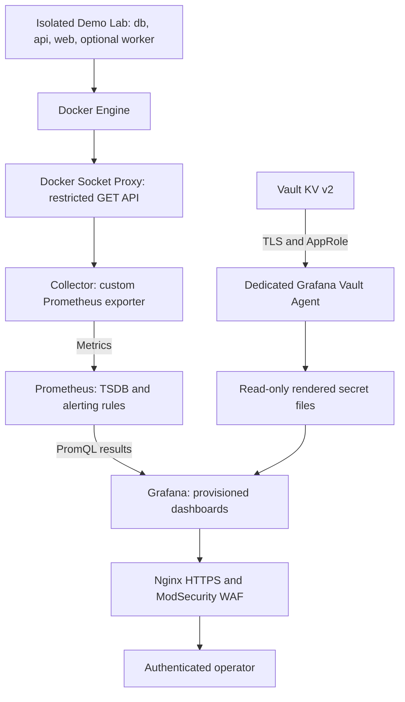

# Development monitoring — Prometheus and Grafana

Issue #142 — DevOps Major module (2 points), ft_transcendence
subject v21.2, section IV.7.

## Purpose and scope

The monitoring stack provides operational visibility into real Docker
service health and the monitoring pipeline itself. It complements,
rather than replaces, the product's interactive topology graph,
incident correlation and incident response features.

The monitored workload is the isolated Demo Lab. The monitoring
pipeline also collects Prometheus self-metrics and Collector scrape
health. Host-wide CPU, memory and disk monitoring are outside this
implementation.

## Architecture



Arrows represent logical data flow. Prometheus actively scrapes
Collector; Grafana actively queries Prometheus.

| Component | Responsibility |
| --- | --- |
| Docker Socket Proxy | Restrict Collector access to the Docker API |
| Collector | Export real Demo Lab container state and health |
| Prometheus v3.15.0 | Scrape metrics, retain time series and evaluate alerts |
| Grafana v13.3.1 | Query Prometheus and render custom dashboards |
| Vault Grafana Agent | Authenticate and deliver Grafana credentials |
| Nginx / ModSecurity | Provide authenticated HTTPS access behind the WAF |

Prometheus and Grafana are on the application default network.
The Docker Socket Proxy remains on `collector_control`, which
Collector also joins. The dedicated Grafana Vault Agent uses
`vault_private`. Grafana itself does not join the Vault network.

## Endpoints and configuration

| Endpoint | Access |
| --- | --- |
| `http://collector:3001/metrics` | Internal application network |
| `http://prometheus:9090` | Internal application network |
| `http://grafana:3000/grafana/` | Internal application network |
| `https://vault:8200` | Private Vault network |
| `https://transcendence.test:8443/grafana/` | Operator access through Nginx |

Neither Grafana nor Prometheus publishes a direct host port.
The Nginx gateway binds to VM loopback only. Browser access
requires the configured hostname, HTTPS trust and, where needed,
an independently reviewed forwarding setup.

Configuration is version-controlled:

- `services/collector/src/metrics.ts`
- `services/collector/src/app.ts`
- `infra/monitoring/prometheus/prometheus.yml`
- `infra/monitoring/prometheus/rules/demo-lab.rules.yml`
- `infra/monitoring/grafana/grafana.ini`
- `infra/monitoring/grafana/provisioning/`
- `infra/monitoring/grafana/dashboards/`
- `infra/vault/agent/grafana.hcl`
- `infra/vault/policies/grafana-readonly.hcl`
- `infra/nginx/default.conf.template`
- `compose.yml`

## Setup and normal operation

Use the guarded development workflow described in
[developer onboarding](dev-getting-started.md).

On a genuinely new development VM, `make initialize` prepares
missing required Docker images before running the guarded provisioning
stages. This includes Prometheus, Grafana and the Python helper image
needed by Grafana's `--pull never` startup. Existing local image tags
are preserved.

For optional image diagnostics (no image downloads), run:

```sh
python3 scripts/dev/bootstrap_images.py plan
python3 scripts/dev/bootstrap_images.py check
```

Independent full-stack acceptance on a clean Ubuntu VM is still required.
Image preparation alone does not initialize Vault.

On an already initialized, unsealed development VM:

```sh
make up
make health
make check-all
```

After reboot, use the existing operator-assisted recovery path:

```sh
make recover
make health
```

The orchestrator verifies Prometheus, Grafana Vault secrets,
Grafana Agent, Grafana and the protected HTTPS endpoint.

It resumes only trusted existing stopped containers during
routine startup and recovery. Missing containers, invalid
credentials and unexpected configuration are not silently
repaired.

An existing installation predating Issue #142 requires an
operator-reviewed monitoring cutover. A Git update alone
does not rebuild Collector, provision new volumes or reload
an existing Nginx configuration. Do not use unrestricted
Compose startup or reinitialize existing Vault state.

### Focused read-only checks

```sh
./scripts/bootstrap.sh --check-prometheus
./scripts/bootstrap.sh --check-grafana-secrets
./scripts/bootstrap.sh --check-grafana-agent
./scripts/bootstrap.sh --check-grafana
./scripts/bootstrap.sh --check-grafana-https
```

### Explicit initial monitoring preparation

The supported initial preparation stages are:

```sh
./scripts/bootstrap.sh --prepare-prometheus
./scripts/bootstrap.sh --prepare-grafana-secrets
./scripts/bootstrap.sh --prepare-grafana-agent
./scripts/bootstrap.sh --prepare-grafana
./scripts/bootstrap.sh --check-grafana-https
```

These commands require the appropriate trusted prerequisites,
images and operator confirmation. They are not interchangeable
with routine startup and are not a complete legacy upgrade
procedure.

## Metrics and exporter integration

Collector implements the custom Prometheus exporter using
the same real Docker snapshot integration as the application.

| Metric | Meaning |
| --- | --- |
| `ft_demo_lab_present` | At least one recognized Demo Lab container exists |
| `ft_demo_service_present` | A container for the named service exists |
| `ft_demo_service_running` | A container for the named service is running |
| `ft_demo_service_healthy` | A running container for the named service is healthy |
| `up` | Prometheus scrape target availability |
| `scrape_duration_seconds` | Scrape duration |
| `scrape_samples_scraped` | Number of samples collected per scrape |
| `prometheus_tsdb_head_series` | Active time series in the TSDB head |

The custom metrics are gauges with a fixed service label
allowlist: `db`, `api`, `web`, `worker`. The label scope
excludes arbitrary container names and secret values.

A value of 1 denotes the corresponding positive state;
0 denotes absence or failure. Health is derived from actual
Docker container state and health checks, not mocked data.

Collector returns HTTP 503 when it cannot produce a valid
snapshot for the metrics endpoint.

Prometheus scrapes itself and Collector every 15 seconds,
evaluates rules every 15 seconds and uses a 10-second scrape
timeout. Time-based TSDB retention is configured for seven days.

## Grafana dashboards

Both dashboards are custom, provisioned from repository JSON,
and use the provisioned datasource UID `ft-prometheus`.
Provisioned dashboards and datasource settings are not
intended to be edited through the Grafana UI.

### Demo Lab - Service Availability

UID: `ft-demo-lab`

```text
Collector scrape
Demo Lab
Firing alerts
Service health history
Alert lifecycle
```

The service history uses real time-series data for required
services and suppresses misleading health display when the
lab is absent or the Collector scrape is unavailable.

### Monitoring Pipeline - Operational Health

UID: `ft-monitoring-pipeline`

```text
Prometheus scrape
Collector scrape
Firing alerts
Scrape duration
Samples per scrape
TSDB active series
```

Together these dashboards provide eleven panels.

## Alerting

Rules are evaluated by Prometheus.

| Alert | Condition | Duration | Severity |
| --- | --- | --- | --- |
| CollectorMetricsUnavailable | Collector scrape is down | 1 minute | critical |
| DemoLabServiceNotHealthy | Required Demo Lab service is unhealthy while the lab exists | 1 minute | warning |

`db`, `api` and `web` are required services. The optional
`worker` does not trigger a required-service availability alert.

If all Demo Lab containers are absent, the required-service
alert is suppressed. Collector scrape failure has a separate
alert.

Alert states are observable through the Prometheus `ALERTS`
metric and the Grafana dashboards. Once a failure persists
for the configured duration, its alert transitions from
pending to firing. Recovery resolves the active alert.

External notifications are not implemented by this module:
no Alertmanager, email, Discord or PagerDuty delivery is
claimed. Alert counts and lifecycle visualization are
provided through Grafana.

## Security and secret delivery

Grafana credentials are generated using cryptographically
secure randomness and stored in Vault KV v2 at:

```text
kv/ft-transcendence/dev/grafana
```

The two fields are `admin_password` and `secret_key`.
Existing valid credentials are preserved.

The dedicated `grafana-reader` AppRole uses the
`grafana-readonly` policy. It can read the Grafana secret
and perform the necessary operations on its own token,
but does not receive access to backend database credentials.

The Grafana Agent authenticates to Vault over verified TLS.
It renders the two secrets into a dedicated volume.
The Agent token sink is on tmpfs, and the AppRole credentials
are held separately from rendered application secrets.

Grafana reads the files from:

```text
/run/secrets/grafana/admin_password
/run/secrets/grafana/secret_key
```

The rendered volume is read-only for Grafana. It does not
receive a Vault root token or AppRole SecretID.

The admin password initializes Grafana's administrator
account. Changing the Vault value alone is not a supported
password rotation procedure for an existing Grafana database.

### Operator access

Open:

https://transcendence.test:8443/grafana/

Use the `admin` account and the securely provisioned
Grafana password. The infrastructure operator must provide
authorized access through an approved private channel.

Do not include credentials in command-line arguments,
screenshots, shell recordings, Git, chat or PR descriptions.

Anonymous API access and public signup are disabled.
The operator must use trusted HTTPS; disabling certificate
verification is not secure acceptance evidence.

The localhost WAF remains active. A narrowly scoped
response-rule exclusion handles known Grafana HTML false
positives without disabling general request inspection.
Grafana routes use restricted audit-log parts and error
logging to avoid the tested credential leakage cases.

Never put secrets in URL paths or query parameters.
The tested logging safeguards do not imply that arbitrary
future routes or every possible secret are automatically
protected.

### Persistent storage

| Volume | Contents |
| --- | --- |
| `transcendence-app-dev_prometheus_data` | Prometheus TSDB |
| `transcendence-app-dev_grafana_data` | Grafana SQLite database and persistent state |
| `transcendence-app-dev_grafana_vault_auth` | AppRole credentials |
| `transcendence-app-dev_grafana_vault_rendered` | Rendered Grafana secrets |

Monitoring services use dedicated mounts. Prometheus and
Grafana run without added Linux capabilities, with read-only
root filesystems and no direct host port mappings.

Do not delete these volumes as a troubleshooting step.

## Evaluation walkthrough

Run this demonstration only on a prepared development VM.
It does not require an outage of the actual application.

### 1. Verify the baseline

```sh
make health
make check-all
make demo-status
```

If the isolated Demo Lab has not been created, use its
documented startup workflow:

```sh
make demo-up
make demo-status
```

Ensure its required services are healthy. Open Grafana
using the trusted HTTPS endpoint and inspect both dashboards
in the Transcendence folder.

The Collector and Prometheus scrape status should be 1.

### 2. Inject a controlled failure

```sh
make demo-fail SERVICE=db
```

This introduces a health failure in the isolated Demo Lab
database service, not in the application's PostgreSQL server.

Observe the service dependency cascade:

```text
db unhealthy -> api unhealthy -> web unhealthy
```

The precise observation time depends on Docker healthcheck
cycles and Prometheus scrape and evaluation intervals.

The Demo Lab dashboard should show the three unhealthy
service histories and then pending alerts. Leave the
failure active until all three alerts become firing.

Do not stop Vault, PostgreSQL, Collector or Prometheus
to demonstrate this scenario.

### 3. Restore the workload

```sh
make demo-recover SERVICE=db
```

Wait for healthchecks and monitoring evaluation.
Verify that all three services become healthy and that
their active alerts resolve.

The historical interval should still show the incident,
including unhealthy samples and pending/firing alerts.

The monitoring pipeline dashboard should show continuing
Collector and Prometheus scrape availability.

### 4. Verify the final state

```sh
make demo-status
make health
```

The demonstration must end with a healthy workload.
If interrupted, run `make demo-recover SERVICE=db` before
leaving the VM.

## Tests and acceptance evidence

### Offline verification

```sh
python3 -m unittest discover -s scripts/dev -p 'test_*.py' -q
(cd services/collector && npm run typecheck && npm run test:cov && npm run build)
```

The Monitoring CI job also validates Grafana dashboard JSON,
Prometheus configuration and alerting rule scenarios using
the pinned Prometheus image.

### Grafana datasource and WAF regression tests

Grafana sends dashboard queries to `POST /grafana/api/ds/query`.
CRS rule 942100 previously rejected four legitimate panels because
libinjection misclassified their PromQL expressions as SQL injection.

The persistent custom policy is stored in:

`infra/nginx/waf/REQUEST-900-FT-GRAFANA-PROMQL.conf`

It is mounted read-only into `/opt/owasp-crs/rules/` and loaded
before the SQL injection detection rules.

The two exclusions apply only to exact approved expression values
in the first or second parsed JSON query expression field, for
POST requests to the exact datasource endpoint with valid JSON.
Duplicate values and collisions with URL parameters prevent the
matching exclusion. Rule 942100 remains enabled for other data,
and inbound anomaly blocking (949110) is not disabled.

Dashboard changes that introduce new false positives require
separate security review; do not broadly disable SQL injection
inspection.

Run the isolated integration test:

```sh
docker pull owasp/modsecurity-crs:4.30.0-nginx-202611090911
python3 scripts/dev/verify_grafana_datasource.py --isolated
```

The isolated test is also part of the Monitoring CI job. It checks
all eleven dashboard request payloads and eight synthetic WAF
security controls without application credentials, persistent
application volumes or application network access.

On an initialized, healthy development VM with the Demo Lab running
and sufficient recent service-health samples, run:

```sh
python3 scripts/dev/verify_grafana_datasource.py --live
```

The live test verifies actual metric samples through trusted HTTPS,
WAF security controls and rejection of anonymous datasource access.
Credentials and raw response bodies are not displayed.

Keep the live integration test separate from routine readiness
checks. A legitimately absent Demo Lab can produce empty service
history; the live test requires a prepared demonstration baseline.

The initial controlled WAF cutover verified all eleven live
dashboard requests, seven live blocking controls, anonymous
access rejection and preservation of unrelated container
lifecycles, persistent volumes, networks and Prisma migration
history. Eight security controls were also verified in isolation.

### Operational verification

```sh
make health
make acceptance
make check-all
```

`make acceptance` runs three guarded startups against a
healthy environment and checks resource identities and
Prisma migration metadata.

### Recorded acceptance — 2026-11-21

Branch: `feat/prometheus-grafana`.
Verified CI commit: `f510c29`.

| Test | Recorded result |
| --- | --- |
| Development regression tests | 585/585 passed |
| Collector tests | 64/64 passed |
| Collector statement coverage | 93.91% |
| Collector branch coverage | 88.65% |
| Custom metrics exporter coverage | 100% |
| Prometheus configuration and rule tests | PASS |
| GitHub Actions | 8/8 jobs passed |
| Monitoring CI job | PASS |
| Live incident lifecycle | Three pending, firing and resolved alerts |
| Historical service health | 11 samples per required service |
| Protected containers during incident | 16/16 preserved |
| Repeated startup | 3/3 passed |
| Startup resource inventory | 12 containers, 12 volumes, 3 networks |
| Controlled Grafana recovery | PASS |
| Grafana password, secret key and AppRole credentials | Preserved during controlled recovery |
| Grafana dashboard and datasource state | Preserved |
| Historical Prometheus data | Preserved |
| HTTPS, anonymous access rejection and WAF tests | PASS |

Recovery verified the same existing Grafana and Agent
containers after an intentional stop/start. The other
managed infrastructure lifecycles remained unchanged.

These results are recorded development acceptance
evidence, not a claim of production backup/restore,
high availability or complete penetration testing.

### Final monitoring acceptance — 2026-11-22

Verified implementation commit: `af6b847`.

| Verification | Result |
| --- | --- |
| Development regression tests | 593/593 passed |
| Collector tests | 64/64 previously passed |
| Final GitHub Actions | 8/8 jobs passed |
| CI duration | 1m 26s |
| Isolated datasource requests | 11/11 accepted |
| Isolated WAF security controls | 8/8 passed |
| Live HTTPS datasource requests | 11/11 returned metric samples |
| Live WAF security controls | 8/8 passed |
| Anonymous datasource access | Rejected |
| Visual dashboard acceptance | 11/11 panels |
| Controlled incident | 3 pending, 3 firing, 0 after recovery |
| Historical incident metrics | Preserved |
| Final Demo Lab state | db, api and web healthy |
| Unified health and readiness checks | PASS |
| Nginx-only WAF cutover | PASS |
| Unrelated infrastructure lifecycles | Preserved during cutover |

The complete baseline-to-failure-to-recovery sequence was
observed in Grafana. The failure was injected exclusively
into the isolated Demo Lab while the application infrastructure
remained operational.

Final merge preparation found no conflicts with the fetched
main branch. Independent clean-VM installation and teammate
upgrade acceptance remain outstanding.

## Subject compliance

| Subject requirement (section IV.7) | Implementation |
| --- | --- |
| Set up Prometheus to collect metrics | Real Collector and Prometheus scrape targets |
| Configure exporters and integrations | Custom Collector Prometheus exporter |
| Create custom Grafana dashboards | Two provisioned monitoring dashboards |
| Set up alerting rules | Two tested Prometheus alerting rules |
| Secure access to Grafana | Vault-backed credentials, controlled exposure, TLS and WAF |

Both dashboards were visually verified in Grafana.
All eleven panels rendered actual monitoring data.
The controlled incident demonstration confirmed three pending
alerts, three firing alerts, successful recovery and retained
historical metrics.

The datasource requests were independently verified through
the trusted HTTPS gateway with certificate verification enabled.
The school evaluator determines final eligibility for the Major module.

## Known limitations

- Development deployment, not a production HA architecture.
- Prometheus and Grafana use the shared application network;
  no direct host ports are published, but network peers can
  reach their internal endpoints.
- No general host CPU/RAM/disk exporter or external alert
  notification delivery.
- The isolated Demo Lab is not the application's database.
- Routine trusted checks still use existing privileged
  development Vault verification helpers.
- Grafana-specific AppRole rotation is not implemented
  by the existing rotation workflow. SecretID expiry
  requires an explicitly reviewed maintenance procedure.
- A complete first-time installation on an independent
  clean VM remains to be accepted.
- Resource identity preservation is not a substitute for
  independent backup and disaster recovery testing.

## Troubleshooting

Start with `make health` and use the reported `--check-*`
stage. Do not automatically create new credentials or
recreate existing containers.

If Grafana secrets, AppRole credentials or persistent state
are missing or inconsistent, stop and contact the
infrastructure owner.

For additional context:

- [Developer onboarding](dev-getting-started.md)
- [Health diagnostics](dev-health-report.md)
- [Reboot recovery](dev-reboot-recovery.md)
- [Startup idempotency](dev-startup-idempotency.md)
- [Demo Lab E2E](demo-lab-e2e.md)
- [Developer commands](../COMMANDS.md)
